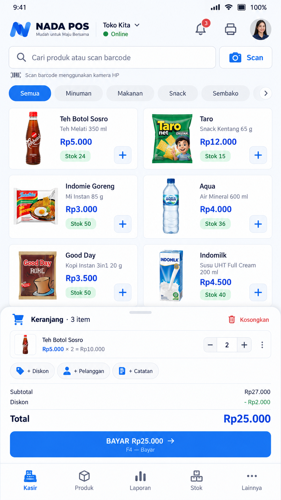

# NADA POS

Aplikasi kasir Android untuk UMKM. Dibangun dengan **Kotlin + Jetpack Compose + Room + Hilt**
(MVVM + Repository), **offline-first**: manifest aplikasi tidak mendeklarasikan izin internet, jadi
seluruh data tersimpan di HP.

Model bisnisnya **freemium**: satu aplikasi untuk semua pelanggan, mulai dari paket Basic gratis,
lalu naik ke Custom atau Pro dengan **kode aktivasi** yang diverifikasi offline.

<p align="center">
  <br>
  <sub>Rancangan antarmuka layar Kasir (referensi desain; tampilan aplikasi sebenarnya bisa berbeda).</sub>
</p>

## Isi

1. [Paket dan fitur](#paket-dan-fitur)
2. [Fitur utama](#fitur-utama)
3. [Teknologi dan struktur folder](#teknologi-dan-struktur-folder)
4. [Build dan menjalankan](#build-dan-menjalankan)
5. [Lisensi dan aktivasi](#lisensi-dan-aktivasi)
6. [Signing dan rilis](#signing-dan-rilis)
7. [CI/CD](#cicd)
8. [Bot trial WhatsApp](#bot-trial-whatsapp)
9. [Data, backup, dan Excel](#data-backup-dan-excel)
10. [Pengujian](#pengujian)
11. [Batasan dan catatan operasional](#batasan-dan-catatan-operasional)
12. [Belum ada (roadmap)](#belum-ada-roadmap)
13. [Status konfigurasi repo](#status-konfigurasi-repo)

## Paket dan fitur

| Fitur | Basic (gratis) | Custom (mulai Rp25rb/bln) | Pro (Rp50rb/bln) |
|---|:-:|:-:|:-:|
| Kasir, barcode, printer Bluetooth, cetak struk + preview | ✅ | ✅ | ✅ |
| Produk, Stok (masuk, keluar, opname), Riwayat transaksi | ✅ | ✅ | ✅ |
| Laporan (harian, bulanan, stok) | ❌ | ✅ | ✅ |
| Import/Export Excel | ❌ | ✅ | ✅ |
| Backup dan Restore (terenkripsi) | ❌ | ✅ | ✅ |
| Custom warna aplikasi dan logo toko (header dan struk) | ❌ | ✅ | ✅ |
| Auto Scan barcode (kamera beruntun) | ❌ | ✅ | ✅ |
| Manajemen Pengguna (Admin/Kasir) | ❌ | ❌ | ✅ |
| Supplier dan Pembelian ke Supplier | ❌ | ❌ | ✅ |
| Outlet / Cabang | ❌ | ❌ | ✅ |
| Hutang / Piutang | ❌ | ❌ | ✅ |

- Paket bawaan instalasi baru adalah **Basic**. Paket naik hanya lewat kode aktivasi yang valid dan
  kembali ke Basic saat langganan kedaluwarsa.
- Data yang sudah dibuat **tidak dihapus** saat paket turun. Layarnya terkunci sampai paket naik lagi.
- Harga dan nama paket didefinisikan di `core/paket/PaketAplikasi.kt`.

**Untuk developer, menambah fitur berpaket:** tambahkan entri di `core/paket/FiturPaket.kt`, pasang
`PaketRouteGuard` pada rutenya di `NadaNavGraph`, dan tambahkan barisnya di `InfoPaketScreen`.
Catatan: **Laporan, Import/Export Excel, dan pilihan warna** saat ini masih dicek langsung dengan
`paket.mencakup(PaketAplikasi.CUSTOM)` (di `NadaNavGraph`, `ProdukScreen`, dan `PengaturanTokoScreen`),
belum lewat `FiturPaket`.

## Fitur utama

**Penjualan**
- Kasir dengan grid produk, keranjang berupa bottom bar ringkas dan bottom sheet, diskon, serta nama pembeli opsional.
- Pembayaran tunai (validasi kembalian), QRIS, transfer, debit, kredit, dan **Piutang** (khusus Pro).
- Transaksi bersifat atomik: simpan transaksi dan kurangi stok dalam satu `withTransaction`.
- Nomor invoice `INV-YYYYMMDD-XXXX` dan nomor antrian yang reset tiap hari.
- Riwayat transaksi dimuat bertahap (100 terbaru, lalu "Muat lebih banyak"). Pembatalan mengembalikan stok dan
  mengubah status menjadi `CANCELLED`, tanpa menghapus data.
- Barcode lewat kamera (CameraX + ML Kit) dan scanner fisik handheld (`HandheldScannerDetector`).

**Struk dan printer**
- Printer thermal Bluetooth 58mm/80mm (ESC/POS) yang sudah dipasangkan. Tidak butuh izin lokasi.
- Preview struk teks sebelum cetak, untuk cetak setelah bayar dan cetak ulang dari Riwayat.
- Logo toko dicetak sebagai gambar (raster `GS v 0`). Printer lama yang tidak mendukungnya mencetak nama toko saja.
- Gagal cetak tidak pernah membatalkan transaksi. Harga beli tidak pernah tampil di struk.

**Inventaris dan pembelian**
- Stok masuk dan keluar manual (stok keluar wajib beralasan), opname, serta riwayat mutasi. Stok tidak boleh minus.
- Pembelian ke supplier (Pro): diterima langsung atau dipesan dulu, diskon baris dan supplier, sisa otomatis menjadi hutang.
- Supplier dengan pencarian, edit, status aktif, dan detail pembelian.
- Outlet / Cabang (Pro): pilih cabang aktif per HP. Transaksi, pembelian, dan perubahan stok manual diberi label cabang.
  Laporan bisa difilter per cabang. Stok tetap satu pool untuk semua cabang.
- Hutang/Piutang (Pro): ringkasan, jatuh tempo, cicilan sampai lunas, dan riwayat pembayaran.
  Omzet laporan memakai dasar akrual (piutang dihitung pada tanggal transaksi).

**Pengguna dan tampilan**
- Login dengan dua peran. **ADMIN** melihat semua menu. **KASIR** hanya Kasir, Lihat Produk (read-only), dan Riwayat
  (bisa cetak ulang, tidak bisa membatalkan).
- Akun pertama `admin` / `admin123` dibuat otomatis hanya saat tabel pengguna kosong. Aplikasi **wajib** meminta
  password baru sebelum bisa dipakai, dan password bawaan ditolak sebagai password baru. Password selalu di-hash.
- Branding dinamis: warna aplikasi dibentuk saat runtime dari data toko (`ThemeConfig`), tanpa rebuild.
- Dashboard (ringkasan hari ini, perhatian stok, transaksi terbaru) dan bottom navigation
  Home / Kasir / Produk / Transaksi / Pengaturan. Ikon notifikasi di header masih placeholder.
- Onboarding saat pertama dibuka. Layar **Info Paket** menampilkan perbandingan paket dan tombol upgrade/trial via WhatsApp.

## Teknologi dan struktur folder

| Komponen | Versi |
|---|---|
| Android Gradle Plugin / Gradle | 8.5.0 / 8.7 |
| Kotlin / KSP | 1.9.24 / 1.9.24-1.0.20 |
| Compose BOM / compiler | 2024.06.00 / 1.5.14 |
| Room, Hilt | 2.6.1, 2.51.1 |
| CameraX, ML Kit Barcode | 1.3.4, 17.3.0 |
| Apache POI (Excel) | 5.2.5 |
| JDK / minSdk / targetSdk | 17 / 26 / 34 |

```
app/src/main/java/com/nada/kasir/
├── core/
│   ├── data/        local (entity, dao, Migrations, AppDatabase) dan repository
│   ├── domain/      logic (kalkulator dan aturan murni yang mudah dites), model
│   ├── lisensi/     validator kode aktivasi, repository lisensi, aturan trial, ID Perangkat
│   ├── paket/       PaketAplikasi, FiturPaket, PaketRepository, AturanBranding
│   ├── backup/      BackupManager, enkripsi, EntityJsonMapper
│   ├── printer/     BluetoothPrinterManager, EscPosBuilder, StrukFormatter
│   ├── excel/       ExcelExporter, ExcelImporter, ProdukRowValidator
│   └── session/ di/ util/
├── feature/         satu folder per layar (kasir, produk, stok, riwayat, laporan, dashboard,
│                    pembelian, supplier, outlet, hutang_piutang, pengguna, backup, login,
│                    onboarding, info_paket, pengaturan_toko, pengaturan_printer, pengaturan_hub, struk)
├── navigation/      NadaNavGraph, SessionHolderViewModel
└── branding/        ThemeConfig

tools/               generate_license.py, generate_keystore.sh
whatsapp-trial-bot/  webhook Node.js (Vercel) untuk trial otomatis
.github/workflows/   android-build.yml, generate-license.yml
```

Aturan umum: `core/` adalah data layer dan logika, `feature/` adalah UI + ViewModel per halaman.
Tidak ada nama toko, warna, atau logo yang di-hardcode. Semuanya dari `StoreEntity` dan tabel `settings`.

## Build dan menjalankan

Butuh **JDK 17**. Android Studio opsional karena Gradle wrapper sudah disertakan.

```bash
./gradlew testDemoDebugUnitTest      # unit test
./gradlew assembleDemoDebug          # APK demo debug  -> app/build/outputs/apk/demo/debug/
./gradlew assembleFullRelease        # APK full release (R8 aktif; lihat "Signing dan rilis")
```

- **Dua flavor** pada dimensi `client`: `full` (`com.nada.kasir`, aplikasi yang didistribusikan) dan
  `demo` (`com.nada.kasir.demo`, bisa terpasang berdampingan dengan versi full).
  Nama aplikasi di launcher ikut membawa versi (`NADA POS v<versi>`).
- Versi dibaca dari `app/version.properties` dan **dinaikkan otomatis oleh CI**. Jangan diedit manual.
- Tanpa file `license.public`, build tetap jalan tetapi APK tidak bisa mengaktifkan kode apa pun
  (ada peringatan Gradle). Build release di CI dihentikan bila file ini kosong.
- Titik kustomisasi per pelanggan: tambahkan flavor baru di `app/build.gradle.kts` (contoh yang dikomentari ada di sana).

Cara tercepat tanpa Android Studio: push ke GitHub, buka tab **Actions**, lalu unduh artifact
`nada-kasir-custom-demo-debug` dari run yang hijau (disimpan 1 hari). Ekstrak, pindahkan APK ke HP, dan instal.

## Lisensi dan aktivasi

Format kode: `NADA-{TIER}-{EXPIRY}-{TANDA-TANGAN}`. `TIER` berisi `CUSTOM` atau `PRO`, dan `EXPIRY` berisi
tanggal `YYYYMMDD` atau `LIFETIME`.

- **Tanda tangan digital ECDSA P-256 (SHA256withECDSA)**, bukan secret bersama. APK hanya membawa kunci
  **publik** (`license.public` → `BuildConfig.LICENSE_PUBLIC_KEY`) yang hanya bisa memeriksa kode, tidak bisa
  membuatnya. Kunci **privat** hanya ada pada pemilik.
- **Terikat perangkat.** Tanda tangan dibuat atas pesan yang memuat **ID Perangkat** (12 hex, mis. `A1B2-C3D4-E5F6`,
  diturunkan dari `ANDROID_ID` dengan SHA-256). Kode untuk HP A tidak valid di HP B. Pelanggan melihat ID-nya di
  **Pengaturan Toko → Status Lisensi** (ada tombol Salin). ID juga otomatis masuk ke pesan WhatsApp dari layar Info Paket.
- Kode lama **tanpa** ID Perangkat **ditolak** (`IZINKAN_KODE_TANPA_PERANGKAT = false` di `LicenseKeyValidator.kt`).
- **Kedaluwarsa dicek** saat aplikasi dibuka (`LoginViewModel`) dan **setiap 5 menit** selama aplikasi hidup
  (`SessionHolderViewModel`). Setelah lewat, paket turun ke Basic.
- Aplikasi mencatat waktu terakhir yang pernah dilihat, jadi memundurkan jam HP tidak memperpanjang langganan.
- Status lisensi adalah milik perangkat: **tidak ikut backup dan tidak ditimpa saat restore**.

### Setup kunci (sekali saja)

1. `python3 tools/generate_license.py --init` (Python 3.8+, tanpa library tambahan). Ini membuat
   `license.private` (**RAHASIA**) dan `license.public`.
2. Commit `license.public` ke root repo (aman, isinya kunci publik).
3. Salin isi `license.private` (64 karakter) ke GitHub Secret **`NADA_LICENSE_PRIVATE_KEY`**, dan simpan cadangan offline
   (mis. password manager). **Jangan pernah commit `license.private`** (sudah ada di `.gitignore`). Bila hilang, tidak ada
   lagi cara membuat kode untuk APK yang sudah beredar.
4. Build ulang APK. `NADA_LICENSE_SECRET` dan `license.secret.example` dari versi lama (HMAC) sudah tidak dipakai.

### Menerbitkan kode untuk pelanggan

Minta pelanggan mengirim **ID Perangkat**, lalu jalankan:

```bash
# Langganan Pro 1 bulan
python3 tools/generate_license.py --tier PRO --bulan 1 --device A1B2-C3D4-E5F6

# Custom sekali bayar (lifetime)
python3 tools/generate_license.py --tier CUSTOM --expiry LIFETIME --device A1B2-C3D4-E5F6

# Cek sebuah kode
python3 tools/generate_license.py --cek NADA-PRO-... --device A1B2-C3D4-E5F6
```

Alternatif tanpa Python lokal: jalankan workflow **Generate Kode Lisensi** dari tab Actions (isi ID Perangkat, tier,
jenis masa berlaku). Hasilnya muncul di *Summary* run. Kirim kode ke pelanggan, lalu mereka memasukkannya di
**Pengaturan Toko → Kode Aktivasi**.

### Trial

Kode trial ditandatangani **kunci terpisah** (`license.trial.public` di root repo, kunci privatnya hanya ada di
server bot), sehingga kebocoran server tidak bisa dipakai membuat lisensi berbayar. Aplikasi hanya menerima kode trial
yang **terikat ID Perangkat**, **bukan LIFETIME**, dan berlaku **paling lama 16 hari** (`LicenseKeyValidator.validasiTrial`).
Kode trial **tidak boleh menimpa paket yang masih aktif** (`AturanAktivasiTrial`). Tanpa file `license.trial.public`,
fitur trial nonaktif.

## Signing dan rilis

1. Jalankan `./tools/generate_keystore.sh` **di komputer sendiri** (bukan di CI atau lingkungan sementara). Skrip membuat
   `release.keystore` dengan alias `nada-pos-release` dan mencetak sidik jari SHA-256.
2. Salin `keystore.properties.example` menjadi `keystore.properties` lalu isi password. File ini dan `*.keystore`
   sudah di-`.gitignore`.
3. Build lokal: `./gradlew assembleFullRelease`. Tanpa `keystore.properties`, build memakai signing debug dan
   **APK-nya tidak boleh dibagikan ke pelanggan**.
4. Untuk CI, isi GitHub Secrets `KEYSTORE_BASE64`, `KEYSTORE_PASSWORD`, `KEY_ALIAS`, `KEY_PASSWORD`
   (`base64 -i release.keystore | tr -d '\n'`). Job `build-release` otomatis aktif begitu `KEYSTORE_BASE64` terisi.

> **Keystore sama pentingnya dengan `license.private`.** ID Perangkat bergantung pada kunci tanda tangan APK
> (Android 8+). Bila keystore hilang atau dibuat ulang, ID semua pelanggan berubah dan **semua kode yang sudah terbit
> berhenti berlaku**. Simpan salinan di dua tempat terpisah dari repo, dan catat sidik jari SHA-256-nya.

Akibat lain: APK **demo dari CI** ditandatangani kunci debug milik runner, sehingga ID Perangkatnya berbeda dari APK full
di HP yang sama. Minta pelanggan mengambil ID dari APK yang akan mereka pakai. Build debug **lokal** memakai keystore rilis
bila `keystore.properties` ada.

Build release memakai R8 (obfuscation dan shrink). **Wajib uji APK release di HP fisik** (Excel, scan barcode, printer, backup,
lisensi) sebelum dibagikan. Aturan pengecualian ada di `app/proguard-rules.pro`.

## CI/CD

| Workflow | Pemicu | Isi |
|---|---|---|
| `android-build.yml` | push dan PR ke `main`, atau manual (opsi `build_demo`) | **`build`**: unit test + APK demo debug (artifact 1 hari). **`build-release`** (hanya bila secret keystore ada): APK full release bertanda tangan, publikasi GitHub Release, lalu naikkan versi otomatis. |
| `bot-test.yml` | push dan PR ke `main` yang mengubah `whatsapp-trial-bot/**` atau workflow ini, atau manual | Menjalankan `npm test` untuk bot WhatsApp (Node.js 20). Terpisah dari build Android dan hanya berizin baca. |
| `generate-license.yml` | manual | Membuat kode aktivasi memakai secret `NADA_LICENSE_PRIVATE_KEY`, hasil di Summary run. |

Detail `build-release`:
- Berhenti bila `license.public` kosong.
- Dari push ke `main`, APK dipublikasikan ke **GitHub Release** `v<versi>` dengan nama aset tetap `NadaPOS.apk`, sehingga
  `.../releases/latest/download/NadaPOS.apk` selalu menunjuk APK terbaru. Dari run selain push (mis. manual), APK disimpan sebagai artifact (7 hari).
- Bila secret **`DOWNLOAD_REPO_TOKEN`** terisi, APK yang sama juga dipublikasikan ke Release `v<versi>` di repo
  [`angga9912/Nada_Pos_Download`](https://github.com/angga9912/Nada_Pos_Download), dan ditandai sebagai **Latest**. Repo itulah yang
  dipakai tombol download di website: `https://github.com/angga9912/Nada_Pos_Download/releases/latest/download/NadaPOS.apk`.
  Token adalah fine-grained PAT yang hanya berlaku untuk repo `Nada_Pos_Download` dengan izin *Contents: Read and write*.
  Bila secret belum diisi, step ini dilewati dengan peringatan dan build tidak gagal.
- Setelah sukses, CI menaikkan `app/version.properties` (`versionCode` +1, patch +1) dan meng-commit dengan `[skip ci]`
  supaya tidak memicu loop. Run manual tidak menaikkan versi.
- `mapping.txt` R8 diunggah sebagai artifact **`r8-mapping-dan-log`** (30 hari). Simpan tiap rilis untuk membaca crash log.

## Bot trial WhatsApp

Folder `whatsapp-trial-bot/` berisi webhook (Node.js 20+, Vercel, penyimpanan Upstash Redis) yang membalas kode trial
otomatis (Custom/Pro, 14 hari) saat pembeli menekan tombol trial di aplikasi atau mengirim ID Perangkat ke nomor
WhatsApp Nada POS. Batasannya: **satu trial per ID Perangkat**, 3 permintaan per nomor per 30 hari, dan 30 trial per hari.

Panduan lengkap (setup Meta, Vercel, variabel lingkungan): [`whatsapp-trial-bot/README.md`](whatsapp-trial-bot/README.md).

## Data, backup, dan Excel

**Database.** Room versi **7** (`MIGRATION_1_2` sampai `MIGRATION_6_7` di `Migrations.kt`), 17 tabel: `stores`, `users`,
`categories`, `products`, `transactions`, `transaction_items`, `payments`, `stock_movements`, `printers`, `settings`,
`audit_logs`, `suppliers`, `outlets`, `purchases`, `purchase_items`, `hutang_piutang`, `hutang_piutang_pembayaran`.
- Indeks untuk kolom yang sering dicari, dan **nomor transaksi unik** di tingkat database.
- Barcode dan kode produk sengaja **tidak** unik di database (produk yang di-soft-delete boleh kodenya dipakai ulang).
  Aturannya dijaga di `ProductRepository`: bentrok hanya dengan produk **aktif**.
- Skema diekspor ke `app/schemas/` saat build (`exportSchema = true`). `MigrasiIndeksTest` memakai skema 7 hasil build.

**Backup.** Menu Backup & Restore menghasilkan file `.nadabak` berisi seluruh data penting (produk, stok, transaksi,
pengaturan, pengguna, printer, supplier, outlet, hutang/piutang, pembelian, audit log, foto). Format backup versi 3, dan
versi 1 dan 2 tetap bisa dipulihkan.
- Dienkripsi **AES-256-GCM** dengan kunci dari password pilihan pemilik (**PBKDF2-HMAC-SHA256**, 150.000 iterasi, salt dan IV acak).
  Password minimal 8 karakter dan **tidak disimpan di mana pun**. Bila hilang, backup tidak bisa dipulihkan siapa pun.
- Restore memvalidasi file penuh dulu, lalu menghapus dan menyisipkan data dalam **satu transaksi**. Bila gagal, data lama tetap utuh.
- "Simpan ke Google Drive" memakai file picker sistem Android (Storage Access Framework), tanpa login Google atau OAuth.
- Backup `.zip` lama (sebelum enkripsi) masih bisa direstore tanpa password.

**Excel.** Export menghasilkan `DATA_PRODUK`, `PENJUALAN`, `STOK_MASUK`, dan `STOK_KELUAR` (`.xlsx`), dibagikan lewat Share Sheet.
Import membaca sheet `DATA_PRODUK` dengan header persis:
`Kode Produk, Barcode, Nama Produk, Kategori, Satuan, Harga Beli, Harga Jual, Stok, Stok Minimum`.
Setiap baris divalidasi, barcode duplikat dilewati, dan semua baris valid disimpan dalam satu transaksi.
Pakai hasil Export sebagai template.

## Pengujian

**Otomatis**
- Aplikasi: `./gradlew testDemoDebugUnitTest` (28 kelas tes, sekitar 219 kasus). Mencakup lisensi dan ID Perangkat,
  enkripsi backup, kalkulator pembayaran dan keuntungan, logika stok/pembelian/hutang/outlet, format struk dan ESC/POS,
  validator Excel, hash password, aturan paket, dan migrasi database.
- Bot WhatsApp: `cd whatsapp-trial-bot && npm test` (Node.js 20+, tanpa dependensi tambahan, 33 kasus).
- CI menjalankan tes aplikasi pada setiap push/PR (`android-build.yml`), dan tes bot lewat `bot-test.yml`
  setiap folder `whatsapp-trial-bot/` berubah.

**Manual di HP**
- [ ] Tambah produk baru, cek muncul di Kasir. Barcode yang sudah ada harus ditolak.
- [ ] Transaksi dengan 2+ produk: subtotal, diskon, dan total benar.
- [ ] Bayar tunai pas → kembalian Rp0. Bayar kurang → "Uang pembayaran belum mencukupi."
- [ ] Setelah bayar, stok berkurang sesuai qty. Qty melebihi stok ditolak ("Stok tidak mencukupi.").
- [ ] Riwayat menampilkan transaksi baru. Batalkan transaksi → stok kembali, status `CANCELLED`.
- [ ] Force close lalu buka lagi: data tetap ada.
- [ ] Restore backup yang sengaja dirusak: ditolak dan data yang ada tidak boleh hilang (uji paling penting).
- [ ] Printer: pasangkan lewat pengaturan Bluetooth HP, lalu Pengaturan Printer → Test Print.
- [ ] Scanner fisik: fokuskan kolom pencarian di Kasir, scan, kode masuk otomatis.
- [ ] Aktivasi: masukkan kode valid, kode salah, dan kode untuk perangkat lain.

## Batasan dan catatan operasional

- **Validasi lisensi berjalan offline di dalam APK**, jadi orang yang sangat berniat masih bisa mem-patch APK agar selalu
  menganggap lisensi valid. R8 mempersulit hal itu. Untuk perlindungan penuh di skala besar, pertimbangkan validasi online.
- **Tidak ada pencabutan kode.** Aplikasi tidak punya izin internet, jadi kode yang sudah terbit tidak bisa dibatalkan.
  Mitigasi: terbitkan kode berlangganan pendek (bulanan) dan hindari kode lifetime.
- Menghapus data aplikasi lalu mengaktifkan ulang sambil memundurkan jam masih bisa lolos dari perlindungan jam.
- ID Perangkat bertahan setelah update atau instal ulang di HP yang sama, tetapi **berubah setelah reset pabrik**
  (pelanggan perlu kode baru).
- Kode trial yang masih berlaku bisa dipakai ulang di perangkat yang sama sampai tanggalnya habis.
- Struk preview menampilkan `[GAMBAR LOGO TOKO]` sebagai placeholder, sedangkan kertas fisik menampilkan logo sungguhan.

## Belum ada (roadmap)

- Nama cabang di struk, filter cabang di Riwayat, dan stok terpisah per cabang.
- Tes migrasi antarversi dengan data nyata (butuh `androidTest` dan emulator).
- Sistem notifikasi (ikon di header Dashboard masih placeholder).
- Validasi dan pencabutan lisensi secara online.

## Status konfigurasi repo

Per 28 Oktober 2026:

| Item | Status |
|---|---|
| `license.public` (kunci lisensi utama) | ✅ ada di repo |
| `license.trial.public` (kunci trial) | ❌ belum ada → trial otomatis nonaktif di APK |
| `app/schemas/` (skema Room hasil build) | ❌ belum di-commit |
| `app/version.properties` | ✅ dikelola otomatis oleh CI |
| Pemeriksaan sidik jari keystore (`KEYSTORE_SHA256`) di CI | ❌ belum diterapkan di workflow (hanya disarankan oleh `generate_keystore.sh`) |
